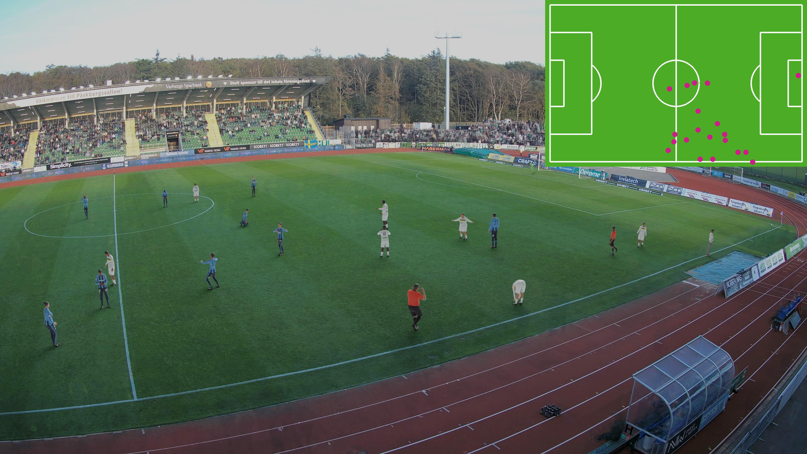
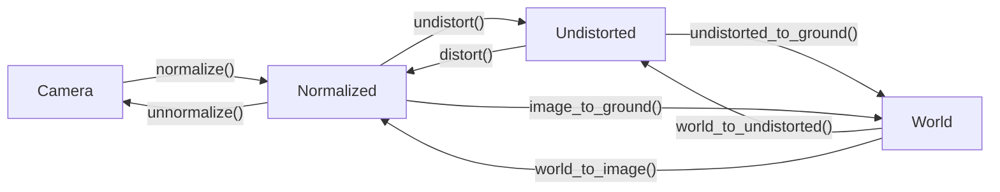
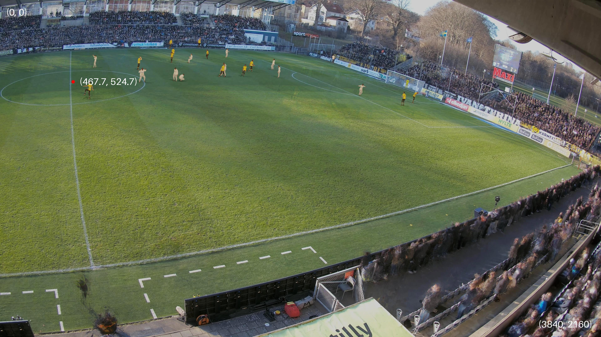
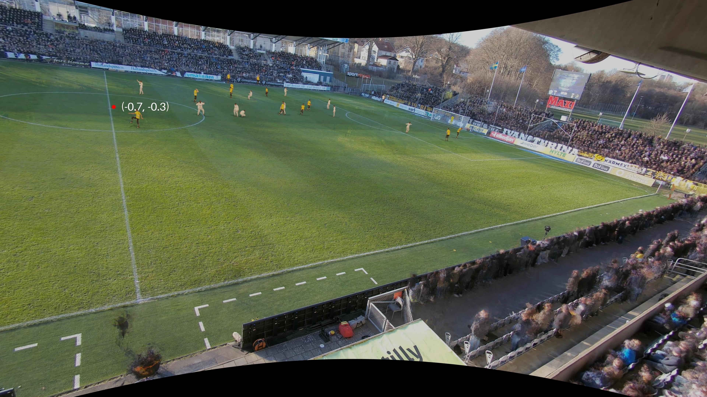
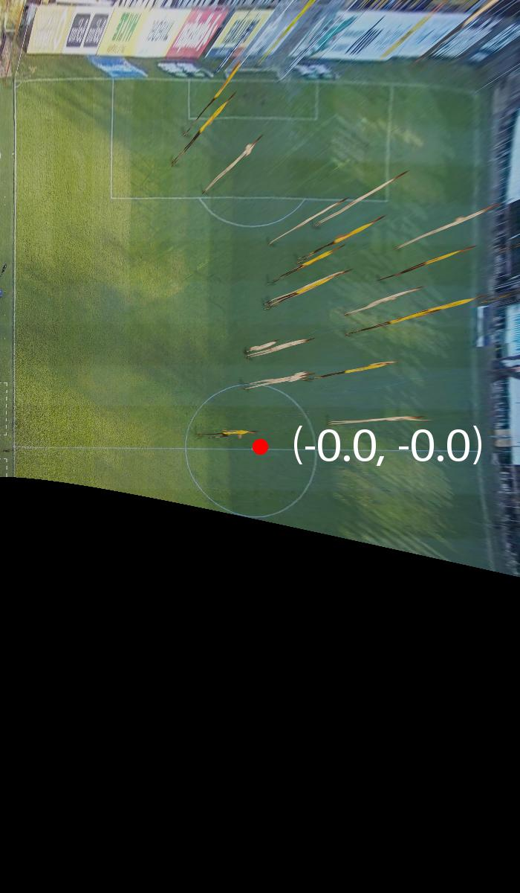

<div align="center">

# Spiideo SoccerNet SynLoc
## Single Frame World Coordinate Athlete Detection and Localization with Synthetic Data

[[Paper](https://www.scitepress.org/publishedPapers/2025/131082/pdf/index.html)] [[Slides](https://docs.google.com/presentation/d/1Eh-pBiOOOENYUm7Hq6aESvvvi3MwappiDwSA7qsqg54/edit?usp=sharing)] [[Baseline](https://github.com/Spiideo/mmpose/tree/spiideo_scenes)] [[Devkit](https://github.com/Spiideo/sskit)] [[Data Download](https://research.spiideo.com/)] [[Leaderboard](https://www.codabench.org/competitions/10128/#/results-tab)] [[Challenge](https://www.codabench.org/competitions/10155/)]
<!-- [[Leaderboard](https://paperswithcode.com/sota/3d-object-detection-on-spiideo-soccernet)] -->

</div>

>**[Spiideo SoccerNet SynLoc - Single Frame World Coordinate Athlete Detection and Localization with Synthetic Data](https://www.scitepress.org/publishedPapers/2025/131082/pdf/index.html)**
>
> Håakan Ardö, Mikael Nilsson, Anthony Cioppa, Floriane Magera, Silvio Giancola, Haochen Liu, Bernard Ghanem, Marc Van Droogenbroeck
>
>[*VISAPP 2025*](https://www.scitepress.org/publishedPapers/2025/131082/)
>




Welcome to the Development Kit for the Spiideo SoccerNet SynLoc task and Challange. This kit is meant as a help to get started working with the data and the proposed task.

## Installation
The easiest way to install sskit is to use pip:
```bash
  pip install sskit
```

It is also possible to build manually:
```bash
  git clone https://github.com/Spiideo/sskit.git
  cd sskit
  python setup.py install
```

## Data Download
The Spiideo SoccerNet SynLoc data can be downloaded from [research.spiideo.com](https://research.spiideo.com/) after registering. Unpack the .zip files in `data/SoccerNet/SpiideoSynLoc`. To automate the download, the [`SoccerNet`](https://pypi.org/project/SoccerNet/) pypi package can be used. It can be installed with:
```bash
  pip install SoccerNet
```

Then, the dataset can be downloaded using:
```python
from SoccerNet.Downloader import SoccerNetDownloader
mySoccerNetDownloader=SoccerNetDownloader(LocalDirectory="data/SoccerNet")
mySoccerNetDownloader.downloadDataTask(task="SpiideoSynLoc", split=["train","valid","test","challenge"])
```

This will download full resolution 4K images. To instead download the smaller fullhd versions, use:
```python
mySoccerNetDownloader.downloadDataTask(task="SpiideoSynLoc", split=["train","valid","test","challenge"], version="fullhd")
```

The downloaded .zip archives then needs to be extracted:
```bash
  cd data/SoccerNet
  for z in *.zip; do unzip $z; done
```

## mAP-LocSim Evaluation

Tools for evaluating a solution using the proposed mAP-LocSim metrics can be found in `sskit.coco`. It's an adaption of
[`xtcocotools`](https://pypi.org/project/xtcocotools/), and is used in a similar way. Annotations and results are stored
in coco format with the ground location of the objects placed in the position_on_pitch key as a 3D pitch coordinate in meters. A minimal results file, res.json, with 3 detections (two in the first image and one in the second) could look like this:
```json
  [
    {
        "area" : 0,
        "category_id" : 1,
        "id" : 1,
        "image_id" : 1,
        "position_on_pitch" : [
          1.2,
          2,
          0
        ],
        "score" : 0.91
    },
    {
        "area" : 0,
        "category_id" : 1,
        "id" : 2,
        "image_id" : 1,
        "position_on_pitch" : [
          5,
          10,
          0
        ],
        "score" : 0.85
    },
    {
        "area" : 0,
        "category_id" : 1,
        "id" : 3,
        "image_id" : 2,
        "position_on_pitch" : [
          10.2,
          20,
          0
        ],
        "score" : 0.83
    }
  ]
```
It can be evaluated against a minimal ground truth file, gt.json, that could look like this:
```json
  {
    "annotations" : [
        {
          "area" : 0,
          "category_id" : 1,
          "id" : 1,
          "image_id" : 1,
          "position_on_pitch" : [
              1,
              2,
              0
          ]
        },
        {
          "area" : 0,
          "category_id" : 1,
          "id" : 2,
          "image_id" : 2,
          "position_on_pitch" : [
              10,
              20,
              0
          ]
        }
    ],
    "categories" : [
        {
          "id" : 1,
          "name" : "person"
        }
    ],
    "images" : [
        {
          "id" : 1
        },
        {
          "id" : 2
        }
    ]
  }
```
using the code:
  ```python
  from xtcocotools.coco import COCO
  from sskit.coco import LocSimCOCOeval

  coco = COCO('gt.json')
  coco_det = coco.loadRes("res.json")
  coco_eval = LocSimCOCOeval(coco, coco_det, 'bbox')
  coco_eval.params.useSegm = None

  coco_eval.evaluate()
  coco_eval.accumulate()
  coco_eval.summarize()

  map_locsim = coco_eval.stats[0]
  frame_accuracy = coco_eval.stats[16]

  score_threshold = coco_eval.stats[15]
```

This will select a score threshold that maximizes the F1-score, which will make that score biased for the validation set.
To get unbiased scores on the test-set, the score threshold found for the validation set should be used there:
```python
  coco = COCO('data/SoccerNet/SpiideoSynLoc/annotations/test.json')
  coco_det = coco.loadRes("res.json")
  coco_eval = LocSimCOCOeval(coco, coco_det, 'bbox')
  coco_eval.params.useSegm = None
  coco_eval.params.score_threshold = score_threshold

  coco_eval.evaluate()
  coco_eval.accumulate()
  coco_eval.summarize()
```

For convenience it is also possible to place the detected location in image space as one of the keypoints. That
image location will then be projected onto the ground plane using the camera model. To do that set the
`position_from_keypoint_index` parameter to the index of the keypoint containing the image location. To evaluate results on the validation set stored in `validation_results.json`, use:
```python
  from xtcocotools.coco import COCO
  from sskit.coco import LocSimCOCOeval

  coco = COCO('data/SoccerNet/SpiideoSynLoc/annotations/val.json')
  coco_det = coco.loadRes("validation_results.json")
  coco_eval = LocSimCOCOeval(coco, coco_det, 'bbox', [0.089, 0.089], True)
  coco_eval.params.useSegm = None
  coco_eval.params.position_from_keypoint_index = 1

  coco_eval.evaluate()
  coco_eval.accumulate()
  coco_eval.summarize()

  score_threshold = coco_eval.stats[15]
  score_threshold = coco_eval.stats[15]
```


## Evaluation server
There are is a [test evaluation server](https://www.codabench.org/competitions/10128/) that evaluates on the public test set and a [challenge evalutaion server](https://www.codabench.org/competitions/10155/) that evaluates on the private challenge set. Submitions to these servers consists of `.zip` archives with one file called `results.json` in the format specified above and one file called `metadata.json` which contains the score_threshold to be used, and optionally the position_from_keypoint_index parameter, if the second convienience format is used. That is:

```json
    {"score_threshold": 0.6848765313625336}
```

or

```json
    {"score_threshold": 0.6848765313625336, "position_from_keypoint_index": 1}
```

## Body Poses and Meshes

The raw SoccerSceneV1 items only store the 55 SMPL-X joint positions of each player (`keypoints` in
`objects.json`), the 10 betas (`smpl_shape`), the gender and the armature world matrix; no pose parameters.
[`convert_pose.py`](convert_pose.py) recovers the pose by inverse kinematics against those joints
(`human_body_prior` IK with the VPoser prior, followed by a prior-free LBFGS refinement to sub-millimetre
residual), poses the gendered SMPL-X mesh and reads off the OpenPose landmarks that are mesh vertices
(nose, eyes, ears, toes, heels). The 14 joint based BODY_25 points are copied verbatim from `objects.json`,
using the smplify-x convention Neck = SMPL-X `neck` and MidHip = SMPL-X `pelvis`.

* `openpose_body25.json` in OpenPose JSON style: for every human `person_id` (= `segmentation_id`),
  `object_key`, `pose_keypoints_2d` (25 x `[u, v, 1.0]`, pixels in `rgb.jpg`) and `pose_keypoints_3d`
  (25 x `[x, y, z, 1.0]`, world/pitch metres). The confidence is a constant 1.0.
* with `--coco-out`, additionally one collected COCO keypoint style file for the whole `--list`. It reuses the
  `images` of the SynLoc bbox annotation file of the same split (`annotations/mini.json` for `mini_v2.txt`, or
  `--coco-images`) and per human the `id`, `bbox`, `area` and `position_on_pitch` of the matching bbox annotation,
  adding flat `keypoints` (25 x `[u, v, 2]`), `keypoints_3d` (25 x `[x, y, z, 1]`, world metres) and
  `num_keypoints`; the category lists the BODY_25 keypoint names and skeleton. Annotation index 8 (MidHip) is the
  same pelvis keypoint as in the bbox file, so `position_from_keypoint_index=8` works with `LocSimCOCOeval`.
* `smplx_params.npz` with the fitted SMPL-X parameters (`betas`, `global_orient`, `body_pose`, `transl`,
  `to_world`, fit residuals) so the meshes can be re-posed with the `smplx` package without refitting:
  `world = to_world @ smplx(betas, global_orient, body_pose, transl)`.

The 2D keypoints are computed with `unnormalize(world_to_image(...))`, i.e. with the principal point at
`((w-1)/2, (h-1)/2)` (pixel centres), which is the convention used throughout `sskit`. Note that the `*_img`
keypoints in `objects.json` were erroneously produced with the principal point at `(w/2, h/2)` and are
therefore 0.7 px off; do not mix the two.

## 3D Pose Evaluation

`sskit.pose` evaluates BODY-25 skeletons against a COCO keypoint ground truth of the kind written by
`convert_pose.py --coco-out` (per annotation `keypoints`, 25 x `[u, v, flag]`, and `keypoints_3d`, 25 x
`[x, y, z, 1]` in world metres; per image a `camera_matrix`). Predictions are COCO results (`image_id`,
`score`, `bbox`, `keypoints`) plus a parallel list of dicts with the 3D skeletons (`keypoints_3d`, 25 x
`[x, y, z]`). Every metric takes a `log` callback for its text report and returns a dict. numpy/scipy only.

```python
from sskit.pose import eval_3d, eval_orientation, eval_ap_k, eval_neck, eval_visibility, matched_pairs

m3d = eval_3d(gt, dets, kp3d, 0.5, print)                   # MPJPE of the IoU-matched people
P, G, (n_gt, n_pred) = matched_pairs(gt, dets, kp3d, 0.5)   # the (N, 25, 3) pairs eval_3d scored
mo = eval_orientation(P, G, print)                          # orientation error of the body axes, degrees
mn = eval_neck(P, G, print)                                 # Neck convention of both sides
mk = eval_ap_k(gt, dets, kp3d, print, thresholds=(0.05, 0.10, 0.15))   # VoxelPose AP_K
mv = eval_visibility(gt, dets, kp3d, print)                 # errors split by the GT visibility flag
```

* **`eval_3d`** matches predictions to GT people per image by box IoU (Hungarian assignment, pairs with
  IoU >= `iou_thr`) and reports, in metres, the global MPJPE (world coordinates), the local MPJPE (root
  aligned; the root is the mean of RHip and LHip on both sides), PA-MPJPE, the root position and the
  distance-to-camera errors, the FIFA-15 subset with the challenge score global + 5 local, and the
  per-joint errors. With `midhip="hipmean"` (default) the predicted MidHip is left out of the averages,
  since hip-midpoint predictors carry no information about the SMPL-X pelvis of the ground truth, and
  its distance to the GT pelvis is reported separately; `midhip="pelvis"` scores it like any other joint.
  `matched_pairs` returns the skeletons of the same pairs, `matched_triples` the annotations and
  detections, and `pose_distance(P, G, use, align)` the MPJPE with `align` none / root / procrustes.
* **`eval_orientation`** gives, over matched pairs, the angle in degrees between the predicted and the
  GT direction of each axis of `BODY25_ORIENTATION_AXES`, as the 3D angle (`<axis>_angle_mean`,
  `_median`) and as the heading difference in the ground plane (z up; `<axis>_heading_mean`, `_median`),
  the fraction turned by more than 90 degrees (`<axis>_flipped`) and the heading error without them.
  Both are placement invariant. An axis is `name -> (from joints, to joints)` with the vector
  `mean(to) - mean(from)`; a facing axis such as ear midpoint -> Nose is a one-line addition.
* **`eval_ap_k`** is VoxelPose's AP_K (Tu, Wang and Zeng, ECCV 2020), a detection-style metric over
  *all* predictions: each prediction is assigned the GT skeleton of its image with the smallest global
  MPJPE, predictions are ranked by score over the whole dataset, a true positive is one whose MPJPE is
  below K and whose GT skeleton is not yet claimed, and AP_K is the VOC-interpolated area under the
  precision-recall curve. `global` is the metric of the VoxelPose paper (`voxelpose_ap` is a literal port
  of its `_eval_list_to_ap`), `root` tests the root-aligned MPJPE of the same assigned pair, i.e. the pose
  alone once the placement is good enough to pick the right person. Keys `AP5`, `recall5`, ... for K in
  cm and `mAP` over the thresholds. Unlike the matched-only MPJPEs it charges misses and spurious
  skeletons. With `flags={2}` only the GT joints with that visibility flag enter the MPJPEs.
* **`eval_neck`** records where the Neck of each side sits relative to the shoulder midpoint in a body
  frame (up, left, back) and the root-aligned Neck error with the predicted Neck relocated to the GT
  offset, i.e. what the predictor's Neck convention costs (the SMPL-X neck joint, the MHR neck joint and
  the OpenPose shoulder midpoint all differ).
* **`eval_visibility`** splits the errors of the matched people by the GT visibility flag of each joint
  (`VISIBILITY_CLASSES`: 2 visible, 1 occluded by a body, 0 outside the image): global, local and PA
  error, 2D pixel error and the per-joint OKS term per class and per joint, plus the orientation errors
  of the people whose axis joints are all visible against the rest. `visibility_subset(gt, flags)`
  restricts a ground truth to the joints of one class (the others unlabelled, as `coco_eval`'s
  `exclude`), so that `sskit.coco.coco_eval` scores the keypoint AP and the 3D-LocSim AP over those
  joints only.

The BODY-25 constants of the module:

| constant | content |
|---|---|
| `BODY25_NAMES` | the 25 OpenPose joint names, Nose, Neck, RShoulder, ... RHeel |
| `BODY25_SIGMAS` | OKS sigmas: COCO's 17, COCO-WholeBody foot sigmas for toes and heels, shoulder-like Neck, hip-like MidHip |
| `BODY25_PAIRS` | the 24 limbs for drawing |
| `BODY25_TO_FIFA15`, `BODY25_TO_COCO17` | the FIFA Skeletal Tracking (15) and COCO (17) joints as BODY-25 indices |
| `ROOT_JOINTS` | RHip and LHip, whose mean is the root |
| `BODY25_ORIENTATION_AXES` | `hips` RHip -> LHip, `shoulders` RShoulder -> LShoulder, `head` REar -> LEar |
| `VISIBILITY_CLASSES` | `visible` 2, `occluded` 1, `outside` 0 |

## Camera model

The camera model used in the dataset is a standard projective pihole camera model with radial distortion.
There are several different coordinate systems used (se pictures below), and functions to convert points
between them can be found in `sskit`. The World coordinates are either 3D or 2D ground coordinates with
the last coordinate assumed to be 0. The graph below shows the different coordinate systems and how they
relate to eachother:


To for eaxample project the center of the pitch, world coordinate (0,0,0), into the pytorch image, `img`, using a
camera matrix, `camera_matrix` and distortion parameters, `dist_poly`, from the dataset, use:
```python
  from sskit import unnormalize, world_to_image

  unnormalize(world_to_image(camera_matrix, dist_poly, [0.0, 0.0, 0.0]), img.shape)
```

A more comprehensive example that was used to create the illustrations below can be found in [`coordinate_systems.py`](coordinate_systems.py).

### Camera Image


### Normalized Image


### Undistorted Image


### Ground Plane


### Citation

If you use this code or data, please cite:

```bibtex
@inproceedings{ardo2025,
  author={Håkan Ardö and Mikael Nilsson and Anthony Cioppa and Floriane Magera and Silvio Giancola and Haochen Liu and Bernard Ghanem and Marc Van Droogenbroeck},
  booktitle={In Proceedings of the 20th International Joint Conference on Computer Vision, Imaging and Computer Graphics Theory and Applications - Volume 2: VISAPP},
  title={Spiideo SoccerNet SynLoc - Single Frame World Coordinate Athlete Detection and Localization with Synthetic Data},
  year={2025},
  pages={278-285},
  publisher={SciTePress},
  organization={INSTICC},
  issn={2184-4321},
  doi={10.5220/0013108200003912},
  isbn={978-989-758-728-3},
}
```
